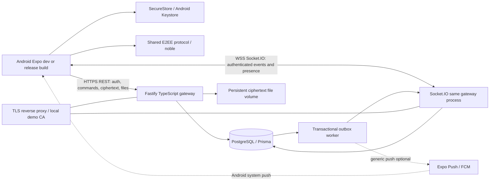

# Kế hoạch hợp nhất — WhisperChat Secure, hạn 30/11/2026

> **Lead sign-off (Claude, 16/11/2026): DUYỆT** với các chốt sau cho mục 10:
> 1. Chấp nhận đưa pinning REST+WSS lên **MUST** (vì demo f là MUST).
> 2. Chấp nhận định nghĩa revoke = DB commit + disconnect có bound đo được (≤1s thường, ≤5s sweep).
> 3. Helper B **không** viết server code mà chính B kiểm thử (giữ độc lập kiểm chứng). Nếu Codex trễ critical path, lead sẽ mở thêm worker server riêng (Helper C) nhận trọn module chưa bắt đầu (ưu tiên T-19 presence/push, rồi T-16 files).
> 4. Defaults policy (recall 10 phút, expiry 60s–24h, không chuyển history, kick/leave mất server history, logout giữ device identity) được dùng cho tới khi user phản đối.
>
> **Amendment A1 (24/11/2026) — đối chiếu với đề cương đã nộp giảng viên (phạm vi chỉ được bằng hoặc hơn):**
> 1. F1: thêm **ảnh đại diện (avatar)** vào hồ sơ: upload qua gateway (không URL bên thứ ba), giới hạn kích thước/MIME, chỉ bạn bè/thành viên chung chat được tải → MUST (T-10 server, T-11 UI).
> 2. F5: thêm **xóa toàn bộ cuộc trò chuyện phía mình** (`POST /chats/:id/clear` — đặt cursor ẩn mọi message ≤ seq hiện tại cho user) và **tìm kiếm tin nhắn cục bộ** trên dữ liệu đã giải mã trong máy (không gửi plaintext lên server) → MUST (T-17 server, T-18 UI).
> 3. F6: **push notification khi app ở nền/bị OS dừng (FCM qua Expo Push, payload generic "Có tin nhắn mới")** nâng từ SHOULD lên **MUST** — vì đề cương ghi "thông báo tin nhắn" và Android sẽ cắt socket khi app ở nền. Chỉ force-stop là ngoại lệ được ghi rõ (T-19, T-20). Cần Firebase project chỉ cho FCM (miễn phí).
> 4. S8: **màn hình Admin tối thiểu trong app** (chỉ hiện khi globalRole=admin: xem audit log, khóa/mở user) nâng từ COULD lên **MUST** để demo RBAC trực quan, kèm test user thường gọi API admin → 403 (T-11, T-15).
> 5. S6: báo cáo/demo phải chứng minh rõ khóa nằm trong **Android Keystore**: SecureStore bọc bằng khóa AES trong Keystore; thêm kiểm tra/ghi nhận hardware-backed (StrongBox/TEE) nếu có; khóa mở biometric dùng `requireAuthentication` (T-07, T-21 g).
> 6. S3: Caddy cấu hình **chỉ TLS 1.2/1.3**, HSTS; test TLS 1.0/1.1 bị từ chối (T-02 bổ sung, T-21).
>
> **Amendment A2 (24/11/2026) — sau khi đối chiếu đề tài các nhóm khác trong lớp L01 (Dang_ky_de_tai_L01.xlsx).** Các mục sau trở thành **MUST** (ghi đè mức SHOULD/COULD ở mục 1, 7, 8):
> 1. **Chống chụp/quay màn hình + che Recent Apps**: FLAG_SECURE (`expo-screen-capture` hoặc config plugin) trên toàn app; màn hình đa nhiệm không lộ nội dung chat. Owner A (T-20, kéo sớm vào T-07). Bằng chứng: ảnh chụp màn hình bị đen, recents bị che.
> 2. **Tắt sao lưu dữ liệu ứng dụng**: `android:allowBackup="false"` + `dataExtractionRules`/`fullBackupContent` loại trừ toàn bộ qua config plugin. Owner A (T-07). Bằng chứng: `adb backup`/merged manifest.
> 3. **Hardening manifest/component**: quyền tối thiểu (liệt kê và lý do từng quyền), mọi activity/service/receiver không cần thiết `exported=false`, deep link (nếu có) chỉ nhận tham số đã validate, không có debug/cleartext trong release. Owner A thực hiện, B kiểm chứng (T-22). Bằng chứng: merged release manifest + checklist trong `docs/security/`.
> 4. **Phát hiện Root/Emulator/Debugger**: cảnh báo và ghi audit (không phải hàng rào tuyệt đối); bản demo cho phép emulator qua cờ build riêng. Owner A (T-20). Bằng chứng: cảnh báo trên emulator/rooted image.
> 5. **Xóa metadata EXIF/GPS của ảnh trước khi mã hóa** (re-encode ảnh ở máy gửi). Owner A (T-18) + C (attachments). Bằng chứng: ảnh nhận được không còn GPS/EXIF.
> 6. **Tự xóa clipboard sau 30 giây** khi người dùng sao chép nội dung tin nhắn. Owner A (T-18).
> 7. **Kiểm tra tệp phía client trước khi mã hóa**: giới hạn kích thước, MIME allowlist, đối chiếu magic bytes; báo cáo giải thích vì sao server không thể quét nội dung (E2EE). Owner C (attachments) + A (picker).
> 8. **Release hardening có bằng chứng**: R8/ProGuard bật cho release, JS biên dịch Hermes bytecode, không log token/key/plaintext ở client (redaction), APK ký bằng release key riêng (không debug key). Owner A + C (T-22).
> 9. Giữ quyết định **không khóa vĩnh viễn tài khoản** (chỉ backoff lũy tiến + rate limit) để chống DoS khóa tài khoản người khác; giải thích rõ trong báo cáo. 2FA/TOTP/Captcha vẫn ngoài scope — duyệt thiết bị mới bằng thiết bị tin cậy đóng vai trò yếu tố thứ hai.
>
> **Thứ tự ưu tiên khi thiếu thời gian:** 8 chức năng + 10 cơ chế trong đề cương (kể cả A1) → A2 mục 1–3, 8 → A2 mục 4–7. Không cắt mục nào trong đề cương đã nộp giảng viên.

Ngày chốt thiết kế: 16/11/2026. Áp dụng quyết định user và D1–D5 trong `01d-lead-review-2.md`; thay thế phương án Firebase/Functions/custom-token và phạm vi chỉ 1-1 trong các bản trước. Đây là **kế hoạch thực hiện**, không phải báo cáo đã triển khai. Lượt này chỉ tạo/cập nhật hai tài liệu `01c-codex-rebuttal.md` và file này, không sửa source.

## 1. Phạm vi, deadline và tiêu chuẩn hoàn tất

Nhóm 3 người, Codex chính, Helper A (Gemini/antigravity) làm client, Helper B (Claude worker) làm tests/demo; mỗi luồng có một thành viên nhóm thật kiểm tra kết quả. Ngày 17–28/11 là 12 ngày code tập trung, bao gồm cuối tuần; 29–30/11 chỉ rehearsal và sửa lỗi chặn demo, không thêm feature. Hợp đồng đóng băng cuối 17/11; checkpoint 18, 21, 24, 27/11. Không có worker nào được khởi chạy trong lượt viết kế hoạch này.

| Mức | Phạm vi |
|---|---|
| MUST | Đăng ký/login/đổi mật khẩu/logout/xóa tài khoản/hồ sơ; tìm/kết bạn; direct + group chat realtime; ảnh/file mã hóa; lịch sử phân trang; presence và notification khi app/socket còn chạy; delete-for-me/recall/expiry; sessions/devices; E2EE, AES-256-GCM, TLS, JWT+refresh rotation, Argon2id, Keystore, biometric lock, RBAC user/admin và owner/admin/member, server rate limit, integrity; attack kit a–f và MASVS evidence. |
| SHOULD | QR tiện dụng bên cạnh fingerprint text; FLAG_SECURE/ẩn recents; cảnh báo root/emulator nhẹ; encrypted full-history cache; push khi process bị kill; video demo pinning/rotation nâng cao. |
| COULD | SQLCipher, admin web dashboard, audit log UI. Server audit log tối thiểu vẫn MUST để kiểm chứng, không phụ thuộc UI. |
| Ngoài scope | Double Ratchet/FS, TOTP, key transparency, chuyển history sang device mới, Play Integrity, iOS/web security parity, Sender Keys, tự động recovery khi mất mọi device, triển khai production/cloud HA. |

**Hai điều kiện tránh tự mâu thuẫn:** attack kit f là MITM chứng minh pinning, nên implementation pinning đủ cho REST + WSS là MUST; chỉ phần trình bày mở rộng là SHOULD. Outbox/auth/device keys mã hóa luôn MUST; chỉ cache đầy đủ lịch sử và SQLCipher mới có thể cắt. Không gửi plaintext trong bất kỳ checkpoint của secure build để thay thế E2EE chưa xong.

Giới hạn MVP: nhóm ≤10 user gồm owner, ≤3 device được duyệt/user, tối đa 30 key wraps/message; text UTF-8 ≤10 KiB, envelope HTTP ≤256 KiB; file 10 MiB plaintext nếu benchmark đạt, nếu không 5 MiB; một attachment/message, không streaming/chunk crypto tự thiết kế. Device mới/thành viên mới chỉ nhận các message mà device đó có mặt trong audience lúc commit. Không FS; không hứa thu hồi bản sao mà người nhận đã giữ.

Notifications khi OS đã giết process/force-stop là hai trường hợp khác nhau: push killed-process SHOULD cần FCM credentials; Android force-stop có thể chặn delivery. Nếu chưa có FCM phải ghi rõ bản MUST chỉ có notification trong trạng thái socket còn hoạt động, không gọi là push nền đầy đủ.

## 2. Kiến trúc đích và threat model



- Node.js TypeScript + Fastify + Socket.IO v4 + PostgreSQL + Prisma, một instance gateway cho demo. Docker Compose có `db`, `gateway`, TLS reverse proxy; named volumes PostgreSQL và ciphertext. DB không publish ra LAN; chỉ TLS port công khai cho điện thoại cùng mạng. Prisma migration và seed demo versioned; không chạy destructive reset mặc định.
- Giữ React Native/Expo và GiftedChat, thay `src/services/*` bằng adapter `src/api/` + `src/realtime/`; bỏ Firebase JS SDK khỏi auth/data. Không còn Firestore/Storage/RTDB Rules trong policy đích; không mint Firebase custom token. FCM/Expo Push, nếu làm, chỉ nhận payload generic qua backend credentials.
- Socket events là **ID/metadata tối thiểu**, không text/file key: message committed/recall/group change → client GET ciphertext có kiểm quyền. REST là đường ghi duy nhất. Reconnect dùng durable cursor/inbox DB, không dựa vào Socket.IO giữ message offline. Theo [Socket.IO delivery guarantees](https://socket.io/docs/v4/delivery-guarantees/), phải tự bổ sung persistence/retry.
- Server được tin để xác thực account, điều phối membership và availability; server/DB không có content/private decrypt key. Mối đe dọa: MITM, client sửa, IDOR, spam/brute force, token reuse, local at-rest extraction, server sửa ciphertext hoặc tráo public key. QR/TOFU hạn chế key substitution; server vẫn thấy metadata thời gian/kích thước/roster, có thể drop/reorder traffic. Endpoint bị kiểm soát khi unlock hoặc recipient cố ý chia sẻ nằm ngoài bảo đảm confidentiality của MVP.

### TLS, pinning và môi trường demo

Tên host/SAN cố định dùng cho gateway, HTTPS và WSS cùng origin; cert CA riêng nhóm/mkcert được trust **theo domain** trong network security config của bản lab, cấm cleartext. Không dùng trust-all hostname verifier. CA private key nằm ngoài repo/APK; app chỉ có CA certificate công khai và SPKI pins chính+dự phòng. Bản release-demo không trust mọi user CA.

Pinning spike ngày 17–18: thử module native phù hợp Expo 58/New Architecture (ứng viên `react-native-ssl-public-key-pinning`), kiểm riêng REST, file transfer, WSS và HTTP polling nếu bật. Không suy ra WebSocket được pin từ fetch pass. Mặc định Socket.IO websocket-only, polling bị tắt cả client/server để giảm surface; nếu mở fallback phải thêm test pinning của polling. Nếu module không bao phủ WSS, native OkHttp transport/hook đã kiểm chứng là phương án sửa tại gate, không fallback unpinned. [Thư viện ứng viên](https://github.com/frw/react-native-ssl-public-key-pinning) chỉ là đầu vào spike, chưa xác nhận compatibility.

Cloudflare Tunnel không nằm trên critical path: đổi TLS termination/host làm thay SPKI/trust model; phải test lại, không tái dùng pin local rồi cho bypass. “Pinning toàn bộ traffic” trong báo cáo chỉ nghĩa traffic ứng dụng tới gateway đã đo; FCM/system traffic không nằm trong pin đó. Service account Firebase không còn prerequisite MUST; chỉ cần nếu làm push SHOULD.

## 3. Auth, phiên, khóa local và quyền

### Tài khoản và token

Password server-side Argon2id: khởi đầu `m=65536 KiB,t=3,p=1`, salt 16 byte ngẫu nhiên, output 32 byte trong PHC string; benchmark laptop demo với tối đa 2 hash jobs song song, mục tiêu p95 250–750 ms. Nếu chỉnh giảm phải ghi số đo và không thấp hơn baseline OWASP Argon2id 19 MiB/2 iterations/1 lane. Policy 12–128 ký tự, không truncate, body cap trước hash; generic error cho sai email/password, dummy hash khi account không tồn tại, limiter trước KDF. [OWASP password storage](https://cheatsheetseries.owasp.org/cheatsheets/Password_Storage_Cheat_Sheet.html).

JWT gateway ES256, access 15 phút: `iss,aud,sub,sid,did,jti,iat,exp`, `kid` allowlist, thuật toán cố định; `role` có thể là hint UI nhưng server đọc role hiện tại. Signing key riêng với TLS/E2EE keys, ở secret mount. Không coi access JWT tự thân là đủ: mỗi protected API kiểm session/device/account; thao tác write kiểm lại trong transaction có khóa liên quan, tránh revoke giữa check và commit.

Refresh token opaque 32 byte random + selector; DB chỉ lưu SHA-256 của random secret, `familyId,sid,parentId,usedAt,expiresAt,revokedAt`. Family absolute max 30 ngày, idle max 7 ngày. Transaction `SELECT FOR UPDATE`: token valid chưa dùng → mark used, insert child, commit rồi trả access+refresh; token đã dùng → revoke cả family/session, audit, disconnect socket. Không log tokens. Client refresh single-flight; strict rotation, mất response hoặc refresh đồng thời có thể buộc login lại, chấp nhận cho MVP; không thêm grace replay khó kiểm chứng. Token records dùng cho phát hiện reuse phải tồn tại tới hết lifetime family, không cleanup ngay sau use.

JWT hết hạn: disconnect socket bằng timer, không chờ packet kế tiếp; client refresh REST rồi reconnect với access mới. Handshake `auth` field, không token trong URL/query. `io.use` chỉ chạy lúc connect nên inbound event có authorization riêng; outbound fanout cũng kiểm session active và audience. [Socket.IO middleware](https://socket.io/docs/v4/middlewares/).

Revoke session: DB commit inactive/family revoked trước, đóng socket đang gắn sid và ghi outbox notification; handler packet đang xử lý recheck khi commit. Một instance dùng registry `sid→sockets`, safety sweep ≤5 giây để xử lý lỗi giữa DB commit và disconnect; không phát dữ liệu mới khi DB đã revoke. Mục tiêu demo disconnect ≤1 giây bình thường, ≤5 giây khi worker phục hồi; không hứa “0 ms” hoặc lấy lại dữ liệu đã nhận. Revoke device đồng thời vô hiệu mọi sessions của device và đổi roster revision. Disable user ngắt toàn bộ sessions. Future multi-instance cần broker/DB invalidation, ngoài MVP.

### Enrollment và Android storage

First device tạo X25519+Ed25519 riêng bằng CSPRNG, đăng ký với self-signed bundle và proof trên challenge server một lần. Login device cũ yêu cầu password + device challenge signature; login device mới chỉ có pending-enrollment quyền hạn chế, existing device duyệt bằng chữ ký trước khi được cấp chat access. Tối đa 3 device, UI cho revoke trước khi thêm. Mất mọi device không có automatic recovery trong MVP: tạo account mới cho demo, không silent reset identity của UID cũ; recovery production là hướng phát triển.

SecureStore giữ private device keys, refresh token và local root key 32 byte theo UID/device; access JWT chỉ RAM. `src/platform/security/` do Helper A quản lý, gọi protocol core từ Codex; biometric gate khi cold start/resume quá 30 giây, clear decrypted UI ngay khi vào background. Chỉ unlock sau auth account phù hợp; không decrypt trước gate. Biometric unavailable/cancel/invalidation phải có trạng thái fail-closed và đăng nhập lại/device re-enrollment rõ, không bypass bằng boolean UI.

Outbox bắt buộc mã hóa AES-256-GCM từng record; AAD bind uid/device/chat/message/schema, nonce random mới mỗi rewrite, atomic temp-write/rename và serialized write queue. AsyncStorage chỉ chứa ciphertext/metadata không nhạy cảm; pending bound UID/device được kiểm cả enqueue và flush. Logout hủy socket, xóa token/outbox/cache rõ của UID; private identity có thể giữ trong SecureStore có yêu cầu biometric để login lại cùng device đọc phần history từng được cấp, không dùng key của account A khi B login. “Remove device/panic” xóa identity/root key và server revoke; mất history trên device đó được cảnh báo. Không cam kết root attacker không đọc được JS memory lúc unlock.

### Ma trận phân quyền server

| Actor | Cho phép | Cấm / điều kiện |
|---|---|---|
| Anonymous | register/challenge/login; health chỉ trả ready | Không directory/chats/files/audit; không chọn role khi register. |
| `user` | hồ sơ mình, search hạn chế, friend transitions của mình, device/session của mình | UID/sid/device lấy từ auth, không từ body để thay actor; block áp dụng send/invite. |
| Platform `admin` | audit metadata, disable user bằng reauth, không cấp role qua client | Không vượt membership/audience để lấy ciphertext; không có decrypt key. Seed admin bằng CLI riêng, không public bootstrap route. |
| Group owner | rename/add/remove, promote/demote admin, transfer owner, dissolve | Chỉ một owner; transfer nguyên tử; owner muốn leave phải transfer hoặc dissolve. |
| Group admin | rename, invite accepted friends của mình, kick member thường | Không kick owner/admin, không đổi role, không tự promote, không dissolve. |
| Group member | read/send nếu active, leave, xóa local; recall message của chính mình trong hạn | Không add/kick/rename/role change. |

Thêm thành viên: invitation → target accept; không tự cưỡng ép user vào group. Direct chat cần quan hệ accepted; group cap kiểm transaction. Role change/membership/key change tăng chat/roster revision; sender đọc snapshot đó để xây envelope. Sender bị kick không được commit sau transaction kick; nếu send commit trước kick thì đó là message hợp lệ của revision trước.

## 4. Mô hình dữ liệu và policy thay Rules

Không còn collections/Firestore Rules trong đích; các bảng SQL, FK/unique/check constraints và authorization service thay thế. Tất cả truy cập qua gateway bằng DB role riêng; password hashes/refresh hashes không serialize vào response. SQL dùng Prisma/parameterized queries, không ghép query từ input. RLS PostgreSQL không thêm trong MVP để tránh hai policy mâu thuẫn; integration test bắt buộc chứng minh mọi repository route đều đi qua authz.

| Bảng/đối tượng | Trường chính và invariants |
|---|---|
| `users` | UUID id, normalizedEmail unique, passwordHash, displayName/about, globalRole user/admin, disabledAt, createdAt; role không writable qua profile. |
| `devices`, `device_key_versions` | id, userId FK, status pending/approved/revoked, keyVersion, X25519/Ed25519 public, bundleSignature, approvingDevice/version/signature, enrolledAt/revokedAt; tối đa 3 approved/account bằng lock user row. Lưu public key lịch sử để verify message cũ, không private key. |
| `sessions`, `refresh_tokens` | sid, uid/did, active/revoked, expires/lastSeen, family; hashes/usedAt/parent. Lookup và rotation transaction; role current từ users. |
| `friendships`, `blocks` | canonical pair unique + requester/recipient/status; accepted/rejected state machine; owner block target, không cho bên kia xóa block. |
| `chats`, `memberships`, `group_invites` | direct/group, creator, metadata name, membershipRevision, nextSeq, dissolvedAt; role owner/admin/member, joinedAt,leftAt; direct pair unique; group active count≤10; one owner enforced bởi transaction/constraint phù hợp. |
| `messages` | chatId/id unique, sender UID/device/keyVersion, senderCounter, seq unique/chat, rosterRevision/hash, envelope JSON, envelopeHash, createdAt server, expiresAt signed, recalledAt; immutable envelope. |
| `message_recipients` | messageId/deviceId/keyVersion unique, userId; audience nguyên bản phục vụ history permission; chỉ device trong audience có thể lấy envelope. |
| `device_message_dedup` | did/counter unique, messageId/hash, acceptedAt; high-water counter device được giữ cả khi message bị xóa; idempotency lookup trước counter check. |
| `message_hides`, `chat_user_state` | uid/messageId hidden; chat unread cursor, archive; delete-for-me đồng bộ user nhưng không xóa message của người khác. |
| `attachments` | object UUID, chat/messageId, owner, expected/max bytes, ciphertext hash, state reserved/uploaded/committed/deleted, expiresAt; opaque server path, không dùng filename user làm path. |
| `inbox_events`, `outbox_jobs` | device audience, cursor monotonically increasing, type + ID/revision; job status/lease/attempts, idempotency key. Ghi cùng transaction message/control event, worker retry sau restart. |
| `audit_events`, `rate_buckets` | actor/action/target/outcome/time/requestId, không plaintext/token; token bucket keys được HMAC/normalize cho email limiter; persistent limits chống restart reset. |
| File volume | `objects/<random-id>.bin` ciphertext; tmp upload riêng, atomic rename; không expose static file route, mọi download kiểm session/membership/audience/expiry. |

Chọn PostgreSQL làm một nguồn transaction. Send khóa chat row và user/device-roster rows theo thứ tự UID cố định; membership mutation và device revoke dùng cùng lock order. `rosterRevision` là `{membershipVersion, userDeviceVersions:[{uid,version}]}` đã sắp xếp; server so trong transaction, không lấy scalar chatVersion mà quên device change. ID counter serialize trên device row. Transaction ghi message, recipients, sequence, events, push job rồi commit; upload file đi trước dưới trạng thái reserved, chỉ reference object đã uploaded và thuộc actor/chat. Job dọn orphan reserved/uploaded quá 1 giờ.

GET message/history/file: session active + account/device active + membership hiện tại + audience nguyên bản + chưa recalled/expired + không hidden theo user. Thành viên đã leave/kick mất quyền tải từ server cả history, dữ liệu đã cache trước không thể thu hồi khỏi client ác ý. Thành viên mới không có audience cũ, kể cả biết message ID. Admin không bypass các điều kiện này. History cursor `(seq,messageId)` và limit≤50; không trả ciphertext của device khác để “client tự bỏ qua”.

Account delete: reauth, revoke toàn session/device trong transaction; user có ownership group phải transfer/dissolve trước; vô danh hóa profile theo policy, dọn private local cache/files mồ côi bằng job. Tin đã gửi còn tồn tại cho recipient tới recall/expiry/retention đã thỏa thuận, không hứa xóa trên máy người khác. Đăng ký lại email không được tái sử dụng UID hay nhận history cũ.

## 5. Protocol E2EE `wc-e2ee-v1`

Đây là protocol đồ án dùng primitives đã có thư viện, **chưa được audit độc lập**. X25519 static + HKDF-SHA256 + AES-256-GCM, Ed25519 ký; chọn per-message fanout cho cả direct/group vì ≤30 devices. Sender Keys có thể giảm chi phí ổn định nhưng thêm sender-chain distribution/epoch/rotation khi kick, không làm trong 12 ngày. Không FS hoặc post-compromise security.

### Serialization, envelope và AAD

Canonical serialization `JCS()` theo RFC 8785, UTF-8, base64url không padding cho bytes; UUID dạng lowercase canonical, timestamps integer milliseconds, counter decimal string canonical để không overflow JS. Reject duplicate JSON keys, unknown schema fields, non-finite numbers, invalid lengths/base64 và version lạ trước crypto. Recipient arrays sort `(userId,deviceId,keyVersion)`, không có phần tử trùng. [RFC 8785](https://www.rfc-editor.org/rfc/rfc8785).

```text
Envelope = {
  version: "wc-e2ee-v1", suite: "X25519-HKDFSHA256-A256GCM-Ed25519",
  header: {chatId, messageId, senderUserId, senderDeviceId,
    senderKeyVersion, senderCounter, type: "text"|"attachment",
    clientSentAt, expiresAt: integer|null, rosterRevision, rosterHash},
  recipients: [{userId,deviceId,keyVersion}],
  payload: {nonce, ciphertext, tag},
  wraps: [{userId,deviceId,keyVersion,salt,nonce,ciphertext,tag}],
  signature
}
AAD = UTF8(JCS({domain:"whisperchat/content/v1",version,suite,header,recipients}))
rosterHash = b64url(SHA256(UTF8(JCS(publicRoster))))
publicRoster = sorted [{userId,deviceId,keyVersion,x25519Public,ed25519Public}]
```

Content key `CK` 32 random byte/message; nonce payload 12 random byte; tag 16 byte. `payload=GCM(CK,nonce,UTF8(JCS(plaintext)),AAD)`. Text/filename/MIME/file key không nằm trong header. Payload type cũng được authenticated; clientSentAt không dùng để quyết định ordering authoritative. `expiresAt` do sender chọn và ký, server chỉ chấp nhận null hoặc tương lai trong 60 giây–24 giờ lúc submit; timestamp cũ quá expiry bị reject, không đổi expiry ngầm sau encrypt. `createdAt/seq` server bổ sung ngoài envelope; client không giả vờ chúng có chữ ký sender.

Mỗi recipient (kể cả thiết bị người gửi để đọc history):

```text
Z = X25519(senderPrivate, recipientPublic)  // reject invalid/all-zero
salt = random(32)
context = {version,chatId,messageId,senderUserId,senderDeviceId,
           senderKeyVersion,recipientUserId,recipientDeviceId,
           recipientKeyVersion,rosterHash}
info = UTF8("whisperchat/keywrap/v1\u0000") || UTF8(JCS(context))
KW = HKDF-SHA256(ikm=Z, salt=salt, info=info, length=32)
wrapAAD = UTF8(JCS({domain:"whisperchat/keywrap-aad/v1",
                   contentAADHash:b64url(SHA256(AAD)),context}))
wrappedCK = AES-256-GCM(KW, randomNonce12, CK, wrapAAD), tag16
signature = Ed25519.sign(senderSigningPrivate,
  UTF8("whisperchat/envelope/v1\u0000") || UTF8(JCS(envelopeWithoutSignature)))
```

`\u0000` ở pseudocode nghĩa một NUL byte trong UTF-8 prefix, không phải sáu ký tự backslash-u; test vector khóa chính xác bytes. Không dùng chung Ed25519 seed và X25519 private key; không tự convert key types. Không dùng Math.random, password hoặc JWT làm E2EE key. Receiver kiểm schema/roster identity trust/signature trước unwrap, kiểm GCM trước parse/render; cùng một generic verification error khi sai.

Server kiểm **chữ ký Ed25519 thực sự**, device bundle đã duyệt, sender binding với JWT, exact recipient set hiện tại, độ dài fields, membership/roster/counter, attachment authorization; chỉ kiểm signature format là không đủ. Không decrypt payload. Vì server không thấy plaintext, size/type content chỉ kiểm client + giới hạn ciphertext; malware scanning server plaintext không có trong E2EE này.

### Retry, replay, roster change

Client serialize outbox theo device counter; persist **nguyên envelope** trước gửi. Retry cùng messageId + envelopeHash trả lại kết quả đã commit (200), không tăng unread/event/push; cùng ID khác hash →409, counter đã dùng cho ID khác →409, đổi chat/sender/recipient làm signature/AAD fail. Counter high-water tăng trong cùng transaction; send client serial để không tự vô hiệu counter thấp còn pending. Counter bị skip do crash được phép tăng, không rollback. Message bị xóa vẫn giữ high-water/dedup metadata trong lifetime device; ID mới không được dùng lại counter cũ.

Nếu roster đổi trước commit →409 `ROSTER_CHANGED`; lấy roster mới, yêu cầu người dùng xác nhận trust change nếu cần, dùng content key/nonce/envelope/counter mới rồi retry thao tác UI có liên kết draft. Đã commit thì trả idempotent kết quả cũ, không tạo message mới ở bước này. Không phát lại plaintext cũ cho device mới để bù history. Member kick/device revoke đọc cùng lock/version với send: linearization là transaction commit, không hứa xóa message commit trước kick.

### File và control messages

Attachment có `attachmentId` do upload-init cấp cho chat/messageId; `FK=random(32)`, file nonce12/tag16; file AAD là JCS `{domain:"whisperchat/file/v1",chatId,messageId,attachmentId}`. Upload raw binary format `magic WCFILE1 || nonce12 || ciphertext || tag16`, không base64 toàn file. Payload E2EE chứa attachmentId/FK/hash ciphertext/size/filename/MIME; server lưu ciphertext hash để kiểm transfer và quota, không lưu FK. Filename ngẫu nhiên trong cache, không auto-export gallery; thumbnail nếu có phải mã hóa riêng, MVP có thể bỏ thumbnail server.

Recall là signed control `{version,domain:"whisperchat/control/v1",action:"recall",chatId,messageId,actorUid,actorDid,actorKeyVersion,controlId,issuedAt}`; server kiểm original sender UID, active member và hạn 10 phút theo createdAt server, idempotent controlId; recipients verify chữ ký trước đánh dấu recall. Delete-for-me là user state, không sửa envelope. Expiry client ẩn/xóa local cache/key khi đến hạn, GET/download server deny ngay dựa clock server kể cả cleanup job dừng; job mỗi 30 giây và catch-up sau restart xóa ciphertext vật lý. Local clock rollback, thiết bị offline ác ý và backup không thể bị bảo đảm xóa tuyệt đối.

### Fingerprint và tính năng nhóm

Identity fingerprint SHA-256 trên JCS public device bundle (UID/device/version/cả hai public keys). Pair safety number dùng danh sách fingerprint của hai user sắp xếp, nên không phụ thuộc bên nào mở trước; group hiển thị fingerprint/trust từng thành viên và roster revision, không một tick verified cho cả nhóm khi còn người chưa verify. QR SHOULD chứa version+UID+bundle fingerprints, so local pin; text comparison MUST. Self-signature chỉ bind bundle, không chống server thay toàn bộ bundle; TOFU/key-change banner MUST, user xác minh ngoài kênh để nâng assurance. Không tự chấp nhận key change trong background.

## 6. Hợp đồng API và socket — khóa ngày 17/11

Sẽ tạo `contracts/openapi.yaml`, `contracts/socket-events.schema.json`, `contracts/e2ee-envelope.schema.json` và `server/prisma/schema.prisma`. Trong lượt này chỉ đặc tả, chưa tạo các file đó. Sau freeze, đổi contract qua lead + một người tích hợp, version/changelog và cập nhật test; UI dùng fixtures contract từ đầu.

Quy ước: `/v1`; JSON lỗi `{code,message,requestId,retryAfterSeconds?}`, không stack/PII. Access Bearer JWT cho mọi route trừ public auth/health; route nhạy cảm yêu cầu recent reauth ≤5 phút. Limit dưới đây là cấu hình demo ban đầu, không benchmark production. Token bucket PostgreSQL persistent, transaction atomic; áp dụng đồng thời IP + uid/sid/device/target như bảng, trả 429 + Retry-After. TLS proxy trusted IP chỉ allowlist internal proxy, không tin X-Forwarded-For tùy ý. Header/body cap áp dụng trước Argon/crypto.

| Endpoint | Auth/kiểm quyền và contract chính | Limit khởi đầu |
|---|---|---|
| `GET /health` | Public, ready only | 60/phút/IP |
| `POST /auth/challenge` | Public; challenge random one-use TTL60s, purpose/login/enroll | 20/phút/IP |
| `POST /auth/register` | Public; email/password/name/device bundle + challenge proof; role=user | 3/giờ/IP, body16KiB |
| `POST /auth/login` | Public; password+device proof; device mới nhận pending handle, không chat token | 10/10phút/IP và 5/15phút/HMAC(email); delay 1/2/4/8/16/30s cap, không khóa vĩnh viễn account |
| `POST /auth/refresh` | Opaque token + device proof cho challenge; strict rotate/family reuse | 30/5phút/IP,10/phút/family |
| `POST /auth/logout`, `POST /auth/reauth` | Own sid; reauth password + device proof, không mở sid mới | 10/phút/sid; reauth thêm login limiter |
| `GET/PATCH /me`, `POST /me/password`, `DELETE /me` | Self; PATCH chỉ name/about; password/delete recent reauth | GET60/phút/uid; mutate10/phút/uid; password/delete3/giờ/uid |
| `GET /users?query=&cursor=` | Auth; username/name prefix, min3 ký tự, ≤20 results, không public email | 20/phút/uid,60/phút/IP |
| `GET /friends`, `POST /friend-requests` | Own; request target valid/not blocked/not self | GET30/phút/uid; request10/giờ/uid,3/ngày/cặp |
| `POST /friend-requests/:id/accept` hoặc `/reject`, `DELETE /friends/:uid` | Only recipient accepts/rejects; either friend removes | 20/phút/uid |
| `PUT/DELETE /blocks/:uid` | Self blocklist, không sửa của target | 10/phút/uid |
| `GET /devices`, `GET /sessions`, `DELETE /sessions/:sid` | Own; revoke session atomic | GET30/phút/uid; revoke10/phút/uid |
| `POST /devices/enroll`, `POST /devices/:id/approve`, `DELETE /devices/:id` | Enroll limited login handle+challenge; approve signed existing device+reauth; revoke own | 5/giờ/uid,3 approved devices max |
| `POST /chats/direct`, `GET /chats` | Accepted friend; unique canonical user pair | create10/phút/uid; list60/phút/uid |
| `POST /groups`, `PATCH /groups/:id` | Create owner; rename owner/admin | 5/giờ/uid; rename10/phút/chat |
| `POST /groups/:id/invites`, `POST /group-invites/:id/accept` hoặc `/reject` | Owner/admin invites accepted friend; target accepts; cap≤10 trong txn | invite20/giờ/chat; response20/phút/uid |
| `DELETE /groups/:id/members/:uid`, `POST /groups/:id/leave` | Theo matrix role; owner phải transfer/dissolve trước leave | 10/phút/chat |
| `PATCH /groups/:id/members/:uid/role`, `POST /groups/:id/transfer-owner`, `DELETE /groups/:id` | Owner only + recent reauth, final owner không bị mất | 5/phút/chat |
| `GET /chats/:id/roster` | Active member; approved device bundles/revisions | 60/phút/uid |
| `POST /chats/:id/messages` | Session/device/member/signature/audience/counter; Idempotency-Key=messageId | 30/phút/device,60/phút/uid,120/phút/chat; burst10 |
| `GET /chats/:id/messages?cursor=&limit=`, `GET /chats/:id/messages/:mid` | Current member + device audience + expiry/recall/hide; max50/page | 120/phút/device; bytes cap/server |
| `POST /chats/:id/read` | Own read cursor only, monotonic valid seq | 30/phút/device |
| `DELETE /chats/:id/messages/:mid/local`, `POST /chats/:id/messages/:mid/recall` | Own hide; recall original author UID+signed control+10min | 30/phút/uid |
| `POST /chats/:id/uploads`, `PUT /uploads/:id`, `GET /attachments/:id` | Reserve actor/chat/message; PUT one-use bound session, ≤cap+format overhead; GET audience+live message | init10/giờ/uid; 2 uploads concurrent/device;100MiB/ngày/uid; GET60/phút/device + byte budget |
| `GET /sync?after=&limit=` | Own device event cursor, max100; expired cursor returns RESYNC_REQUIRED | 30/phút/device |
| `GET /presence?userIds=` | ≤10 accepted friends/shared-chat users, permission per target | 30/phút/device |
| `PUT/DELETE /devices/:id/push-token` | Own active device; SHOULD | 10/giờ/device |
| `GET /admin/audit`, `POST /admin/users/:id/disable` | DB globalRole=admin; disable reauth; no self-lockout of sole admin | audit30/phút/admin;disable5/phút/admin |

File GET không phục vụ bearer URL sống lâu; mọi retry vẫn kiểm quyền. Authz failure không tiết lộ tài nguyên tồn tại: 404 cho foreign object ID, 403 cho action bị cấm trên object đã được đọc hợp lệ. Rate limits độc lập authorization, không lấy limiter làm chống IDOR.

Socket `/socket.io`, WSS same host, protocol version1:

| Direction/event | Payload / invariant |
|---|---|
| Handshake | `auth:{accessToken,protocolVersion:1}`, max2 connections/sid, rate10/phút/IP; server gắn uid/sid/did, client không tự join room. |
| Server `inbox.changed` | `{eventId,cursor,kind,chatId,objectId,revision}`; kind message/recall/group/device; ID-only, không crypto key/text. |
| Server `presence.changed` | `{userId,online,lastSeen}` chỉ recipient được phép; server không cho tự khai userId presence. |
| Server `session.revoked`, `session.expiring` | Chỉ hint UI; security do DB+disconnect/timer, không dựa client tự logout. |
| Client `sync.request` | `{after,limit≤100}` cùng checks `/sync`, 30/phút/device; unknown events rejected, packet≤8KiB. |
| Client `event.ack` | `{cursor}` own stream monotonic,30/phút/device; ACK không thay read-receipt chat. |

Socket.IO presence: online khi có ≥1 socket authenticated còn active/không hết hạn cho user; chỉ fanout friends/shared members. Explicit disconnect grace10s; pingInterval10s/pingTimeout10s để phát hiện network loss, mục tiêu offline≤30s khi foreground theo thử thiết bị; suspend Android không bảo đảm giữ socket. Không gọi socket connected đồng nghĩa user đang nhìn màn hình. Reconnect kéo durable events qua `/sync`, dedup eventId, rồi REST hydrate; if cursor retention7ngày hết thì full authorized chat sync. Outbox delivery at-least-once, UI idempotent.

## 7. Task breakdown, owner, file và acceptance

Ownership cố định: **C = Codex** server/contracts/protocol/API+socket adapters/integration; **A = Helper A** screens/components/contexts/App/native security UX/config plugin; **B = Helper B** tests/fixtures/attack kit/docs. Thành viên người thật tương ứng chịu nghiệm thu. Shared `package.json`/lockfile/root scripts chỉ C sửa sau khi A/B gửi dependency request; `app.config.js`, `plugins/` chỉ A; `src/security/` chỉ C, test đặt ngoài tại `tests/security/` do B. Không giao cùng file cho hai worker; task phụ thuộc có handoff trước chỉnh.

| ID / ngày / phase | Owner, file được sửa trong giai đoạn thực hiện | Công việc và dependency | Acceptance cụ thể |
|---|---|---|---|
| T-01 ·17/11 P0 | C: `contracts/*`, `server/prisma/schema.prisma` | Freeze API/socket/envelope/schema theo mục3–6; lead review cùng A/B | Contract fixtures cho auth/direct/group/expiry; rejected unknown fields; review sign-off 17/11, không endpoint thiếu owner. |
| T-02 ·17–18 P0 | C: `server/package.json`, `server/src/app.ts`, `server/src/db/*`, `compose.yaml`, `infra/*`, root package/lock | Fastify/Prisma/Postgres/migrations/TLS/volumes, health; phụ thuộc T-01 | Compose up không seed destructive; restart giữ DB/files; phone thật truy cập HTTPS, DB không lộ LAN. |
| T-03 ·17–18 P0 | A: `src/screens/Users.js`, `src/contexts/*`, `src/App.js`, `app.config.js`, `plugins/*` | Fix TDZ/self-chat; dev/release build, CA domain policy, pinning REST+WSS spike; phối hợp API skeleton T-02 | Mở Users không ReferenceError, self-chat không tạo duplicate; release APK cài phone; HTTP/trust-all không được dùng; pinning spike có kết quả cả hai transport. |
| T-04 ·17–18 P0 | B: `tests/regression/*`, `tests/contracts/*`, `security-demo/README.md`, `tests/security/vectors/*` | Baseline 9 Jest, test outbox/retry/account-switch, vector fixtures và demo harness; phụ thuộc T-01 | Failure tái hiện 4 nợ cũ trước fix; contract fixtures không chứa secret; test plan gửi C/A cuối18. |
| T-05 ·18–20 P1 | C: `server/src/auth/*`, `server/src/sessions/*`, `server/src/devices/*`, migrations | Argon/JWT/challenge/enroll/refresh/reuse/revoke, max3 devices; T-02 | Parallel refresh chỉ1 rotation; reuse revoke family; other sid vẫn sống; old JWT/signed request không vượt revoke; benchmark Argon. |
| T-06 ·19–20 P1 | C: `server/src/policy/*`, `server/src/rate-limit/*`, `server/src/audit/*` | Middleware role/object/session, PostgreSQL limiter/log redaction; T-05 | 429+Retry-After, restart không reset bucket; wrong role/actor denied; audit không tokens/password/plaintext. |
| T-07 ·19–21 P1 | A: `src/platform/security/*`, auth/account screens, root/context từ T-03 | SecureStore, biometric gate, account namespace, logout; gọi C auth API | Lock/resume/cancel không lộ plaintext; refresh survive process restart an toàn; A→B không đọc/gửi outbox A; biometric invalidation fail closed. |
| T-08 ·19–21 P1 | C: `src/api/*`, `src/realtime/*`, `src/services/*`, `src/config/firebase.js`, root dependencies | Auth client single-flight + transport adapters; bỏ Firebase auth/data imports; kết nối T-05/T-07, chuẩn bị socket | No Firebase Auth refresh/custom token còn được gọi; token chỉ auth header; no direct Firestore/Storage path; lost ACK không gửi duplicate. |
| T-09 ·20–21 P1 | B: `tests/server/auth*`, `tests/server/session*`, `tests/server/limits*`, `security-demo/auth-*` | Fastify inject/supertest trên Node HTTP adapter + DB test riêng; T-05/T-06 | login brute-force, refresh reuse, role downgrade, stale JWT, concurrency đều asserted; không dùng prod DB. |
| T-10 ·21–22 P2 | C: `server/src/users/*`, `server/src/friends/*`, `server/src/groups/*`, migrations | Profile/friends/block/direct/groups/owner matrix; T-05/T-06 | Group11 bị chặn; add cần consent; admin không kick owner/admin; owner transfer atomically; direct pair unique concurrent. |
| T-11 ·21–23 P2 | A: Profile/Users/Group/ChatInfo/Devices/Friends/Settings screens và components | UI theo contract, new-device approve/revoke, group add/kick/rename/role; T-08/T-10 | Hai máy friend accept, group3 người, role controls phản ánh backend; lỗi forbidden có UX; helper không tự ghi DB. |
| T-12 ·18 spike,22–24 P3 | C: `src/security/*`, `server/src/crypto-verification/*` | Noble protocol/KDF/JCS/signatures/trust/outbox crypto; T-01/T-05/T-10 | Known vectors + golden envelope cross Node/Hermes; content never plaintext server; 30 wraps measured; AEAD/key-change fail closed. |
| T-13 ·22–24 P3 | C: `server/src/messages/*`, `server/src/events/*`, `server/src/socket/*`, `server/src/jobs/*`, `src/services/chatMessageService.js` | Commit/audience/roster locks/counters/idempotency/inbox/WSS/reconnect; T-10/T-12 | Lost ACK/concurrent retry =>1 row/event/unread; kick vs send race linearized; device mới không history; socket expires/revokes; reconnect không mất tin. |
| T-14 ·23–24 P3 | A: Chat/Chats/ChatHeader/ChatInfo UI, `src/components/SafetyNumber*` | Render decrypted payload qua service, trust warning/fingerprint text; QR SHOULD; T-11/T-12/T-13 | Direct+group3 người có E2EE, message malformed không render; member mới không đọc history; key change có banner, không auto trust. |
| T-15 ·22–24 P3 | B: `tests/security/*`, `tests/server/group*`, `tests/server/message*`, `security-demo/idor*`, `tamper*`, `replay*` | Vectors và adversarial tests; T-12/T-13 | RFC7748/8032/5869, NIST GCM vectors; modified nonce/tag/header/wrap/signature reject; 30-device fixture; stale roster/kick/replay/IDOR checks. |
| T-16 ·24–26 P4 | C: `server/src/files/*`, `src/security/attachments*`, `src/api/files*` | Ciphertext upload/download/object auth/quota/orphan cleanup; T-12/T-13 | Không static route; outsider/new device/kicked/expired không tải; tamper file fail; 1/5/10MiB benchmark và cap quyết định có evidence. |
| T-17 ·24–26 P4 | C: `server/src/messages/*`, `server/src/jobs/*`, `src/services/chatMessageService.js` sau T-13 | History cursor/read/hide/recall/expiry, encrypted outbox atomic storage integration T-12 | 150 message paginate không thiếu/trùng; recall sender10min only; expiry GET/file deny dù cron dừng; restart cleanup catch-up; locked disk không text. |
| T-18 ·25–27 P4 | A: Chat/Chats UI sau T-14, `src/platform/storage/*`, attachment picker/viewer | Doc/image picker, retry UI, older history, delete/recall/TTL; full cache SHOULD, outbox MUST; T-16/T-17 | Ảnh/PDF encrypt→upload→decrypt; one attachment cap rõ; cache plaintext tạm dọn lock/logout/expiry; delete-for-me không xóa của người khác. |
| T-19 ·25–26 P5 | C: `server/src/presence/*`, socket fanout sau T-13, `server/src/push/*` SHOULD | Presence socket/grace/privacy; optional durable push jobs; T-13 | Offline network loss theo timeout đo; revoked sid không online; người ngoài không presence; push receipt/retry nếu credentials có. |
| T-20 ·26–27 P5 | A: `src/services/notificationService.js`, status UI, native security config sau T-07 | Local notifications generic, optional push registration; FLAG_SECURE/root warning SHOULD | Screen locked không preview text; foreground/background-socket demo; killed-process test ghi pass/not-supported trung thực; screenshot protection nếu chọn. |
| T-21 ·25–27 P4/P5 | B: `security-demo/*`, `tests/server/files*`, lifecycle/socket tests, `docs/security/*` | Kit a–f mandatory + g at-rest, MASVS map; phối hợp T-03/T-16/T-17 | Scripts self-contained/guard/reset, machine assertions; MITM REST+WSS control vs pin; fixture hashes/evidence redacted. |
| T-22 ·27–28 P5 | C: integration ở vùng C, root build scripts/CI; A sửa vùng A; B chỉ tests/docs | Review contract drift/dependencies, zero plaintext bypass, release signing/package, final acceptance | Tất cả MUST pass trên release phone+emulator; chỉ sửa bug, không thêm feature28/11; missing MUST ghi blocker. |
| T-23 ·29–30 rehearsal | B: `docs/demo/*`, evidence; C/A xử lý blocker trong vùng riêng | Demo 10–15 phút, setup/reset dự phòng, nhóm người thật tập trả lời | Hai lượt từ clean seed, offline artifact fallback, không dùng secret/prod, nhóm giải thích no-FS/metadata/expiry limits đúng. |

### Lịch ba luồng và checkpoint

| Ngày | Codex | Helper A | Helper B | Gate chạy được |
|---|---|---|---|---|
| 17–18 | contract, Compose/DB/auth skeleton | APK/CA/pinning spike/bug Users | regressions/contracts/vectors/demo scaffold | **18/11:** phone HTTPS+WSS, DB persistent, contract freeze, native/pinning feasibility; failing infrastructure được xử lý ngay. |
| 19–21 | auth/session/RBAC/limits + client adapters | auth UX/Keystore/biometric/devices skeleton | auth concurrency/brute-force/session checks | **21/11:** signup/login/refresh/revoke/socket disconnect/biometric, dữ liệu local nhạy cảm không rõ; admin authorization thật. |
| 22–24 | groups + protocol + atomic messages | friends/groups/chat/trust UI | group permissions/vectors/tamper/replay | **24/11:** direct+group E2EE trên phone/emulator, offline reconnect, kick/new device negative tests. |
| 25–27 | files/history/lifecycle/presence | attachments/delete/TTL/notifications | full attack kit/MASVS/file/expiry | **27/11:** đủ8+10, a–f, ảnh/file, expiry và offline presence; cap10/5MiB đã đo. |
| 28 | integration/fix blockers | fixes/release UI | full regression/artifact | Freeze release cuối28; không dùng rehearsal để viết core còn thiếu. |
| 29–30 | hỗ trợ demo/triage | physical device rehearsal | runbook/evidence/presentation | Hai lần demo lặp được, danh sách giới hạn rõ. |

Critical path: T-01→T-02→T-05/T-06→T-10→T-12/T-13→T-16/T-17→T-22. A/B làm fixtures và UI từ contract, không đợi backend hoàn thành. Codex có tải lớn nhất; nếu chậm, lead có thể giao Helper B một module server **chưa bắt đầu** kèm chuyển owner nguyên file, không hai agent sửa chung. Không giả định “thêm AI” tự loại bottleneck tích hợp.

Gate trượt: cắt COULD trước, rồi SHOULD (QR graphical/full-cache/root-warning/FCM) trong ngày; không cắt AES/outbox, group E2EE, authz, session revoke, 8+10 hoặc a–f. Nếu MUST chưa pass, đánh dấu chưa hoàn thành và báo lead/user ngay; deadline không cho phép đổi tên một thiếu sót thành feature đạt. File cap5MiB là fallback đã được lead cho phép, không tự xuống thấp hơn nếu chưa đồng ý.

## 8. Attack kit, bằng chứng và mapping yêu cầu

Kit chạy trên project DB/host demo có allowlist, không chạy production. Mỗi script có prerequisites, seed roles/users/devices, command, expected HTTP/socket/UI, assertion và cleanup; destructive tamper cần `--demo-only` + xác nhận database ID. Script không ghi password/token/key vào report; log requestId và kết quả đã redaction. Client test build control/unpinned và pinned có package ID khác, control không được phát hành như secure APK.

| Demo | Nội dung và expected result | Task |
|---|---|---|
| a | Brute-force login vượt ngưỡng →429/Retry-After/backoff; account hợp lệ không bị khóa vĩnh viễn bởi attacker; restart không reset limiter | T-06,T-09,T-21 |
| b | Third user đoán chat/message/file ID qua REST, forged room/event qua socket →404/403, không dữ liệu; kicked/new device history deny | T-10,T-13,T-15,T-21 |
| c | Tamper1byte ciphertext bằng SQL fixture quyền demo (thay Admin SDK vì bỏ Firebase), hoặc tag/AAD/wrap/signature → client “Không xác thực được tin nhắn” | T-12,T-15,T-21 |
| d | Replay khác messageId/chat/counter →reject; exact retry cùng hash→idempotent200, đúng1 message/unread/event, không push trùng | T-13,T-15,T-21 |
| e | RefreshR1→R2 rồi reuseR1 →family+sid revoked, socket disconnect, access JWT cũ không ghi/đọc; sid độc lập không bị revoke nhầm | T-05,T-09,T-21 |
| f | Proxy CA trusted trong control build: REST/WSS qua MITM thành công; cùng CA trust ở pinned lab build nhưng sai gateway SPKI→cả REST/file/WSS fail; direct gateway vẫn pass | T-03,T-21,T-22 |
| g | Dump AsyncStorage/cache sau lock/kill trên rooted emulator→không plaintext/password/refresh/private key; chỉ ciphertext ngoài SecureStore, thử decrypt bằng key sai thất bại | T-07,T-12,T-17,T-21 |

Với f phải có negative-control có cùng trust policy để tách tác dụng TLS trust và pinning; bản pinned release-demo trở lại domain CA hạn chế. Với g không khẳng định root không thể hook/decrypt ở runtime unlock; plaintext đang ở UI/memory là giới hạn phải giải thích. a–f đều MUST; g thực hiện nếu môi trường root sẵn, kiểm outbox/secrets encryption vẫn MUST dù không quay được demo dump.

Mapping dùng **nhóm control MASVS**, không tuyên bố toàn bộ control/certification đã đạt. Backend auth/rate limiting/RBAC cần thêm ASVS-style API checks; MASVS không phải bộ test chức năng chat. Nguồn taxonomy: [OWASP MASVS index](https://cheatsheetseries.owasp.org/IndexMASVS.html).

| Yêu cầu | Task triển khai/kiểm chứng | Bằng chứng demo dự kiến | Nhóm MASVS liên quan |
|---|---|---|---|
| F1 Account/profile | T-05,T-07,T-08,T-10,T-11 | 2 accounts register/login/edit/password/logout/delete policy | AUTH,PRIVACY,STORAGE |
| F2 Search/friends | T-10,T-11,T-15 | search/accept/remove/block, không lộ email toàn DB | AUTH,PRIVACY |
| F3 1-1 + group realtime | T-10–T-15,T-19 | direct/group3 người, offline sync, kick/send race | NETWORK,AUTH,CRYPTO |
| F4 Image/file | T-16,T-18,T-21 | ciphertext disk, ảnh/PDF mở đúng, outsider/tamper denied | STORAGE,CRYPTO,PLATFORM |
| F5 History/manage | T-13,T-17,T-18 |150 messages pagination, device mới không đọc cũ | STORAGE,AUTH,PRIVACY |
| F6 Presence/notification | T-19,T-20,T-21 | network loss/offline timeout, generic local notification; push nếu SHOULD đạt | NETWORK,PLATFORM,PRIVACY |
| F7 Recall/delete/expiry | T-17,T-18,T-21 | delete local vs recall all, expired GET deny khi cron tắt | AUTH,STORAGE,PRIVACY |
| F8 Devices/sessions | T-05,T-07,T-11,T-13 | add/approve3 devices, revoke device/sid, reconnect denied | AUTH,STORAGE |
| S1 E2EE cả direct/group | T-12–T-15 | server không đọc text;30wrap fixture; kick không có future key | CRYPTO |
| S2 AES-256-GCM | T-12,T-16,T-17,T-21 | NIST vector/tag tamper/file và outbox ciphertext | CRYPTO,STORAGE |
| S3 TLS/HTTPS/WSS | T-02,T-03,T-21 | no HTTP; TLS chain/hostname validation, f | NETWORK |
| S4 JWT+Refresh | T-05,T-08,T-09 | access expiry,rotation/reuse e và revoke | AUTH |
| S5 Safe password hash | T-05,T-09 | PHC Argon params benchmark, salt khác cùng password; không plaintext DB | AUTH,CRYPTO; backend ASVS |
| S6 Android Keystore | T-07,T-12,T-21 | key/token protected restart, wrong-key decrypt fail, g | STORAGE,CRYPTO |
| S7 Biometric lock | T-07,T-14,T-22 | cold/resume/cancel không lộ UI, enrollment change fail-closed | AUTH,PLATFORM |
| S8 RBAC/access | T-06,T-10,T-15 | admin/user và owner/admin/member negative matrix, b | AUTH; backend ASVS |
| S9 Rate limiting | T-06,T-09,T-21 | a + send/upload/friend quotas qua custom client | AUTH,NETWORK; backend ASVS |
| S10 Integrity | T-12,T-13,T-15,T-21 | c,d; signature/tag/AAD/version validation | CRYPTO |
| Bonus fingerprint/QR | T-12,T-14,T-15 | compare text MUST,QR SHOULD; key substitution banner | CRYPTO,AUTH |
| Bonus FLAG_SECURE/recents | T-07,T-20 | screenshots/recents không hiển thị chat nếu bật | PLATFORM,STORAGE |
| Bonus root/emulator warning | T-20 | warning có giới hạn, không coi là access-control boundary | RESILIENCE |
| Bonus full encrypted cache | T-17,T-18,T-21 | offline history ciphertext at rest nếu SHOULD đạt | STORAGE |
| Bonus pinning | T-03,T-21 | f bắt buộc, backup pin rotation walkthrough optional | NETWORK |
| Bonus audit/MASVS evidence | T-06,T-09,T-21,T-23 | audit redacted + evidence index, không cần admin web UI | AUTH,PRIVACY,CODE |

## 9. Kiểm thử, migration và trạng thái hiện tại

Baseline khảo sát trước: Jest2 suites/9 tests pass, lint pass; local Android build exit1 do không có `android/`; chạy trực tiếp Rules tests bị thiếu emulator, không có bằng chứng Rules assertions fail. **Không chạy lại test/build trong lượt tài liệu này**, không thể gọi các acceptance dự kiến là đã đạt. Sau D1, bộ Rules không còn là release gate chính; thay bằng SQL/API/socket authorization tests. Giữ file test cũ trong lịch sử hoặc chuyển legacy qua thay đổi review riêng, không để test Firebase xanh thay bằng chứng backend mới.

Tầng test: protocol golden vectors cùng Node/Hermes; server transaction tests với PostgreSQL test container và Fastify inject (supertest nếu dùng HTTP adapter); socket.io-client thật kiểm connect/expiry/reconnect; Android release manual+automation cho biometrics/pinning/key storage/file memory. External push dùng mock khi unit/integration, chỉ ghi live pass khi phone nhận thực. Không dependency install/prebuild/migration/deploy nào được thực hiện trong lượt này.

Migration đề xuất demo mới hoàn toàn: freeze old app, tạo database demo mới, đăng ký user/key mới; không import plaintext chat/outbox tự động, không dùng email để gán quyền history. Gỡ Firebase SDK/imports/config data paths sau khi adapter mới chạy; root deps do C sửa, A cập nhật contexts/screens qua contract, B xác nhận không còn network call Firebase ngoài push nếu được bật. User phải xác nhận quyền reset dữ liệu demo cũ trước thao tác, không xóa source/DB thật do tài liệu này.

Rehearsal 10–15 phút: auth + friend/group → E2EE text/file + DB ciphertext → kick/new device → biometric → a/b/c/d/e/f chọn thao tác live ngắn và evidence còn lại → recall/expiry/presence → giải thích no-FS, metadata, offline/force-stop, pinning scope. Có video/artifact backup nhưng phải ghi là ghi trước, không giả thành live. Hai Android identities có thể chạy phone thật + emulator; group tối thiểu3 users dùng thêm emulator,30-device test là synthetic fixture riêng.

## 10. Bất đồng còn lại và quyết định mở

**Không phản đối D1.** Một auth/database boundary, socket do nhóm kiểm soát và local file store phù hợp deadline và môn học hơn hybrid Firebase đã trở nên phức tạp. Những giới hạn cần ghi rõ:

1. “Pinning bao phủ toàn bộ traffic” là mục tiêu cần kiểm chứng, không hệ quả tự động của bỏ Firebase: JS REST/WebSocket có thể đi các client native khác nhau; FCM nếu thêm nằm ngoài gateway. Gate18 kiểm cả WSS/REST, không demo chỉ một endpoint rồi tuyên bố toàn hệ thống.
2. D4 xếp pinning SHOULD nhưng yêu cầu attack kit a–f MUST có f MITM; bản này đưa implementation pinning đủ cho f vào MUST. Nếu lead muốn cắt pinning thì phải công bố f chưa đạt, không dùng lỗi CA trust để thay kết quả.
3. Revoke “ngay” nghĩa ngăn request mới sau DB commit và disconnect có bound đo được, không đảm bảo rollback message đã gửi hoặc không có packet đang trên dây. Socket middleware handshake một lần chưa đủ; timer và per-operation DB checks là bắt buộc.
4. 12 ngày là ràng buộc user, tải critical path Codex còn cao; lịch trên chỉ khả thi khi 3 luồng làm việc mỗi ngày, contract freeze17/11, build/pinning gate18 đạt, không bổ sung production recovery/HA. Chưa có performance evidence noble30 devices hoặc10MiB; fallback5MiB được phép, không tự hứa đạt trước benchmark.

Các câu hỏi user/lead cần chốt đầu17/11, không mở lại quyết định backend/group/deadline:

- Ai là ba người phụ trách C/A/B và có thể làm lịch tập trung17–28 gồm cuối tuần? Máy demo có Docker, RAM cho Postgres/emulators, LAN không client isolation và host/SAN ổn định chưa?
- Xác nhận dataset demo mới, có được reset fixture/DB riêng; dữ liệu hiện tại phải giữ ở đâu? Không tự reset tài khoản thật.
- Chọn hostname/CA lab, release-demo signing và thiết bị Android/API level để ghi benchmark/biometric/pinning; có thêm emulator đủ group3 users không?
- Chấp nhận defaults recall10phút, expiry60s–24h, không chuyển history, leave/kick mất server history, logout giữ device identity bảo vệ để login lại? Đây là UX/security policy cần thông báo rõ.
- Có Firebase/EAS/FCM credentials để làm push SHOULD trước24/11 không? Nếu không, chạy socket notification và ghi killed-process chưa hỗ trợ; MUST backend không chờ Console/service account.
- Ai giữ server JWT key/CA private key và seed admin? Secrets ngoài repo, chỉ public CA/pins trong app; không gửi service-account JSON/password qua báo cáo.

Phần MUST được chốt khi từng hàng mapping có test/evidence thật, không chỉ UI xuất hiện hoặc API trả200. Các điểm còn mở có default kỹ thuật trong tài liệu để tiếp tục implementation, nhưng thay đổi policy dữ liệu hoặc cấp quyền/deploy vẫn phải theo phạm vi user đã cho phép.
